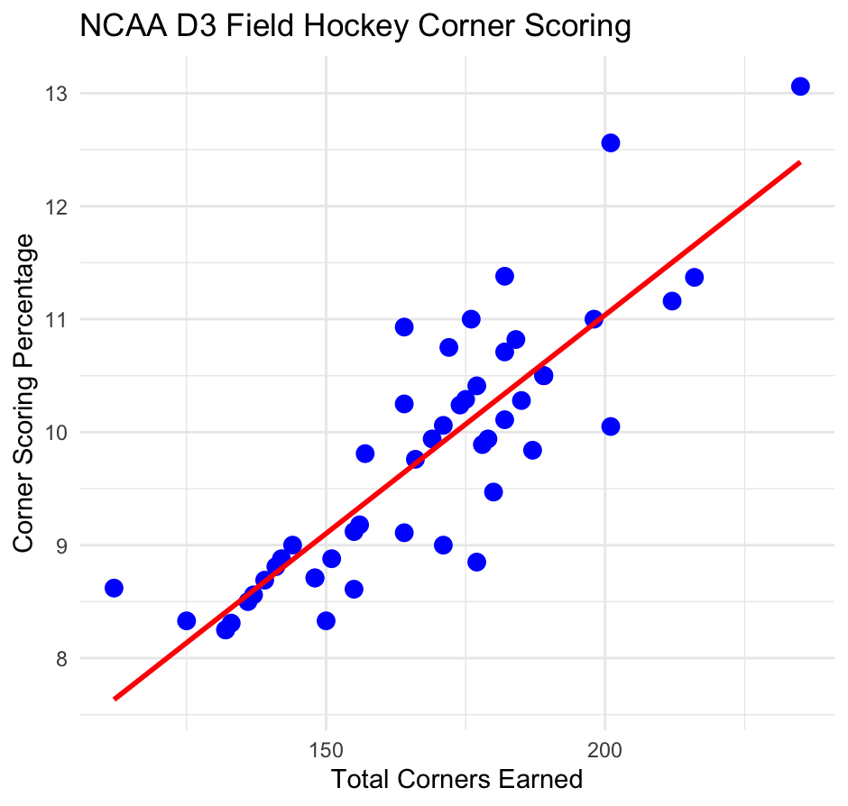

# Field-hockey-corner-data

**ANALYSIS** the scatter plot compares the total number of penalty corners earned by NCAA Division 3 field hockey teams with thier corner-scoring percentages. each points represents an individual team. the purpose of this grpah is to examine whether teams that earn more penality corners are also more successful at converting those opportunites into goals. 
The graph allows us to compare both the quantity or corners earned and the efficiency with which teams score from them. Teams located in the upper-right portion of the graph have both a high number of corners earned and high scoring percentage. In contrast, teams in the lower-right portion earn many corners but have a lower scoring percentage. 
The overall tren line helps show whether there is a positive or negative relationship between the two variables. this can help determine whether earning more penalty corners is associated with a higher scoring percentage or whether earning more penalty corners is associated with a higher scoring percentage or whether the two variables are relatively independent. 
 
This bar chart is showing the top 50 teams in the NCAA Division 3 field hockey with the highest scoring percentage on corners. 

This bar chart is shoing the top 50 teams in the NCAA Division 3 field hockey with the highest amount of corners earned. 
[view the dataset and excel workbook](PDP_corners.xlsx) 

